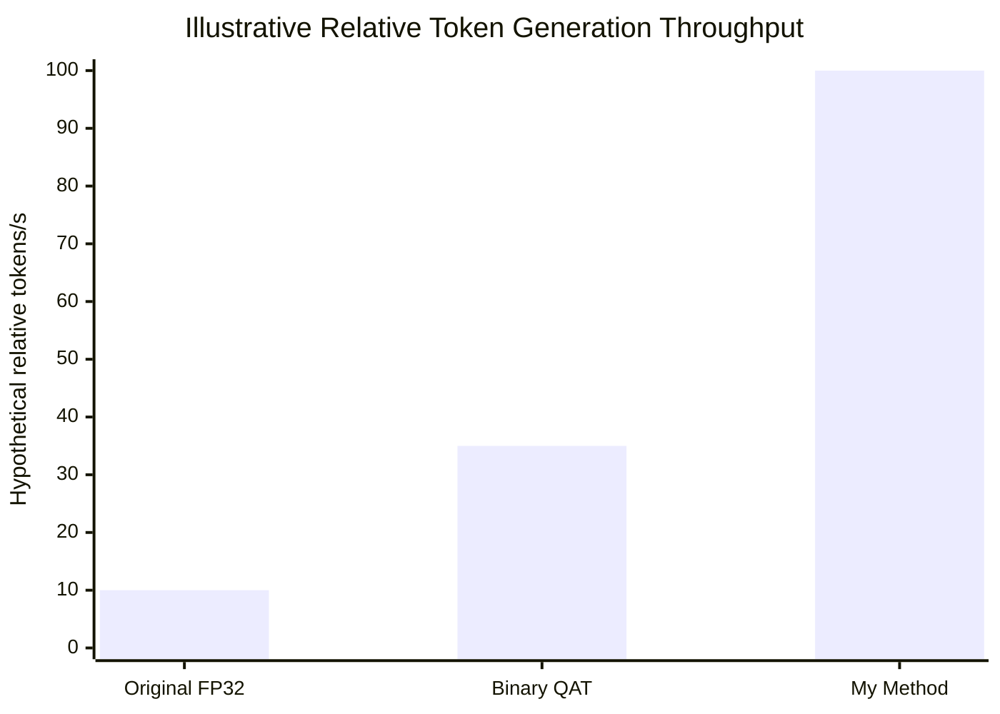

# Qwen2-0.5B: Binary QAT vs. Scalar-Group Weight Compression

An experimental comparison of binary quantization and an extreme weight-compression approach that represents each group of 128 weights with a single learned scalar.

The goal is to investigate whether dramatically reducing weight storage can improve autoregressive inference throughput while maintaining acceptable model quality. The current results are preliminary and do not yet demonstrate competitive quality or a measured inference speedup.

## What is compared

| Method | What is stored | Estimated bits per weight |
|---|---|---:|
| Original FP32 | Every weight in FP32 | 32 |
| Binary QAT | One binary sign per weight + one FP16 scale per 128 weights | ~1.125 |
| My Method (Scalar-Group) | One FP16 scalar per 128 weights | ~0.125 |

**Binary QAT** learns individual weight signs using a straight-through estimator and optimizes a scale for each group of 128 weights.

**My Method (Scalar-Group)** replaces all 128 weights in each group with one learned scalar. The original signs are used only for initialization; they are not stored in the final representation. The scalar is optimized against the original weights, using a straight-through estimator to simulate FP16 rounding during training.

This reduces the estimated storage requirement by approximately 9× compared with Binary QAT and 256× compared with FP32 weight storage. These ratios describe weight storage only, excluding metadata, activations, temporary buffers, and other model components.

## Experimental protocol

- **Model:** `Qwen/Qwen2-0.5B`
- **Layers:** All linear layers except `lm_head`
- **Group size:** 128 weights
- **Dataset:** WikiText-2 raw (`Salesforce/wikitext`)
- **Training:** 256 random blocks of 128 tokens from the training split, using a fixed seed
- **Validation:** 32 consecutive blocks from the validation split
- **Testing:** 32 consecutive blocks from the test split, evaluated once at the end
- **Training duration:** 3 epochs
- **Optimizer:** AdamW
- **Learning rates:** Sign parameters: `1e-3`; scales: `1e-4`; scalar constants: `1e-3`

## Results: Model quality

Single run, seed 42.

| Method | Test perplexity (lower is better) | Mean test loss |
|---|---:|---:|
| Original FP32 | 29.39 | 3.381 |
| Binary QAT | 664.74 | 6.499 |
| My Method (Scalar-Group) | 1174.41 | 7.069 |

The scalar-group method currently has worse perplexity than Binary QAT. Further training and improved representations are needed before drawing conclusions about its achievable model quality.

## Theoretical inference-speed potential

The following chart illustrates a **hypothetical relative-throughput scenario**, not measured generation speeds. My Method is shown as the highest-throughput scenario because its compact representation could reduce weight-memory traffic substantially.



**Important:** The values 10, 35, and 100 are illustrative units, not measured tokens/s, and do not establish a real speedup factor.

### Why could this approach accelerate inference?

Autoregressive generation repeatedly reads model weights. When inference is memory-bandwidth-bound, reducing the amount of weight data transferred from memory can potentially increase token throughput.

- **Original FP32:** Stores 32 bits per weight.
- **Binary QAT:** Stores one bit per weight plus a scale for each 128-weight group. An efficient kernel must interpret the signs and apply the scales.
- **My Method:** Stores one FP16 scalar per group of 128 weights. It eliminates per-weight sign storage and could reduce memory traffic further.

The main challenge is implementing efficient kernels that apply each scalar to its group directly during computation, without reconstructing and storing the full weight matrix. Scalar expansion, arithmetic overhead, hardware support, and other bottlenecks may limit the actual speedup.

The theoretical 256× reduction in weight-storage data compared with FP32 does **not** imply 256× faster token generation. Actual throughput must be benchmarked on the same hardware, with identical batch sizes, context lengths, and generation settings.

## Limitations and next steps

- Run several random seeds and report mean perplexity and variability.
- Add an untrained scalar-group baseline.
- Improve the scalar representation and training procedure to close the quality gap.
- Compare against established 4-bit methods such as GPTQ and AWQ under the same evaluation protocol.
- Benchmark actual tokens/s using optimized inference kernels.
- Evaluate memory consumption, prefill speed, decode speed, and model quality on additional models.

The current test set contains only 4,096 tokens, and training uses a limited number of blocks. The reported results are preliminary and should not be used to predict scaling behavior or production performance.

## Running the experiment

### Google Colab (T4)

```python
!git clone https://github.com/<your_username>/qwen2-sign-compression.git
%cd qwen2-sign-compression
!pip -q install -r requirements.txt
!python compress_eval.py
```

Select a T4 GPU under **Runtime → Change runtime type**.

The original estimate for the training and evaluation run is approximately 1–1.5 hours, depending on hardware and runtime conditions.

To use a different random seed:

```python
!SEED=1 python compress_eval.py
```

### Local execution (VS Code)

```bash
git clone https://github.com/<your_username>/qwen2-sign-compression.git
cd qwen2-sign-compression
python -m venv .venv
source .venv/bin/activate  # Windows: .venv\Scripts\activate
pip install -r requirements.txt
python compress_eval.py
```

CPU execution is possible but may be very slow. A GPU is recommended.

## Files

- `compress_eval.py` — data loading, training, and evaluation for both methods.
- `requirements.txt` — Python dependencies.
