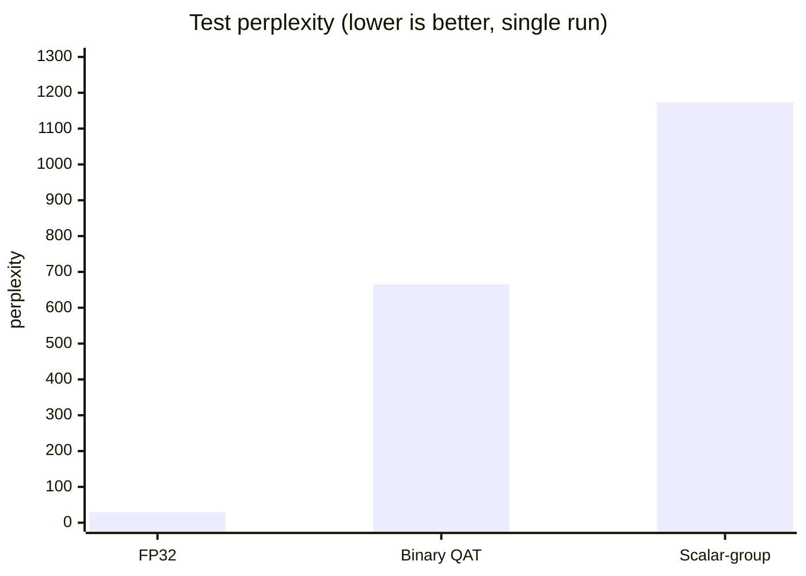

# Qwen2-0.5B: Binary QAT vs. one learned scalar per 128-weight group

Experimental intermediate result. The method does not yet reach quality close to the original model. The goal of this repository is to honestly compare two compression variants on one model under one protocol.

## What is compared

| Method | What is stored | Bits per weight (estimate) |
|---|---|---|
| Original FP32 | all weights | 32 |
| Binary QAT | 1 sign per weight + one scale per group of 128 | ~1.125 (with FP16 scales) |
| Scalar-group | 1 constant per group of 128 | ~0.125 (with FP16 constants) |

Binary QAT learns the signs (via a straight-through estimator) and the scales. Scalar-group learns one constant per group: signs are used only for initialization, and in the forward pass each group is replaced by that constant.

## Protocol

- Model: `Qwen/Qwen2-0.5B`, all linear layers except `lm_head`, group size 128.
- Data: WikiText-2 raw (`Salesforce/wikitext`).
- Train: 256 random blocks of 128 tokens from the train split (fixed seed).
- Validation: 32 consecutive blocks from the validation split. Used to monitor training.
- Test: 32 consecutive blocks from the test split. Evaluated once, at the end.
- 3 epochs, AdamW, learning rates: signs 1e-3, scales 1e-4, constants 1e-3.

## Results

Single run, seed 42.

| Method | Test perplexity | Mean test loss |
|---|---|---|
| Original FP32 | 29.39 | 3.381 |
| Binary QAT | 664.74 | 6.499 |
| Scalar-group | 1174.41 | 7.069 |



Notes on the table:

- Earlier runs gave Binary QAT 1497 and 1736, and the full model 27.9 and 30.8. The spread between runs is large, so a single number is not a reliable result.
- The test set is only 4096 tokens. The difference within one run may be inflated or deflated by sampling noise.
- Scalar-group stores roughly 9 times less data than Binary QAT and, in this run, reaches about 1.8 times its perplexity.

## What is not done yet (and needed before drawing conclusions)

- Several seeds per method, with mean and spread.
- A control point for Scalar-group without training (constant = mean of the original group weights).
- Comparison on other models and against 4-bit methods (GPTQ/AWQ) under the same protocol.
- More training data: 256 blocks for 3 epochs is too little to recover the model after binarization.

Do not draw conclusions about how this method scales from this repository.

## Running

### Google Colab (T4)

```python
!git clone https://github.com/<your_username>/qwen2-sign-compression.git
%cd qwen2-sign-compression
!pip -q install -r requirements.txt
!python compress_eval.py
```

Runtime → Change runtime type → T4 GPU. The full run (both methods, 3 epochs) takes about 1–1.5 hours.

For a different seed:

```python
!SEED=1 python compress_eval.py
```

### VS Code (local)

```bash
git clone https://github.com/<your_username>/qwen2-sign-compression.git
cd qwen2-sign-compression
python -m venv .venv
source .venv/bin/activate        # Windows: .venv\Scripts\activate
pip install -r requirements.txt
python compress_eval.py
```

The script runs on CPU without CUDA, but very slowly. A GPU is strongly recommended for reproduction.

## Files

- `compress_eval.py` — data loading, both methods, training, evaluation.
- `requirements.txt` — dependencies.
